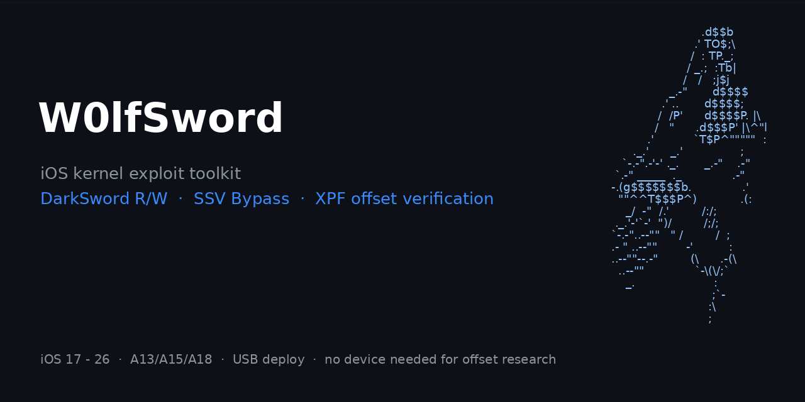
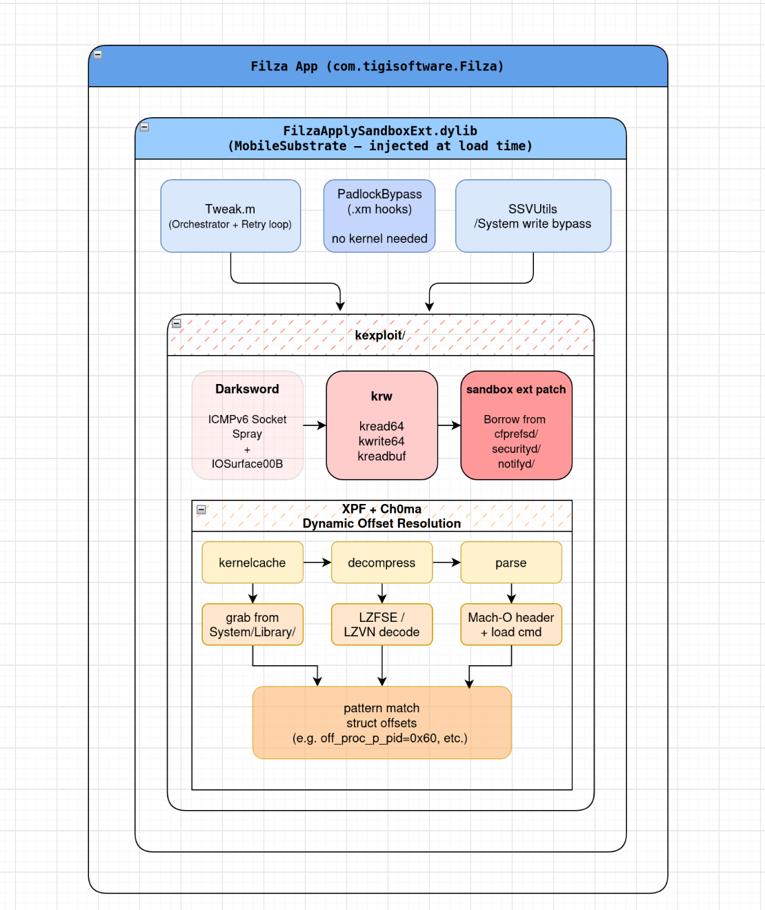
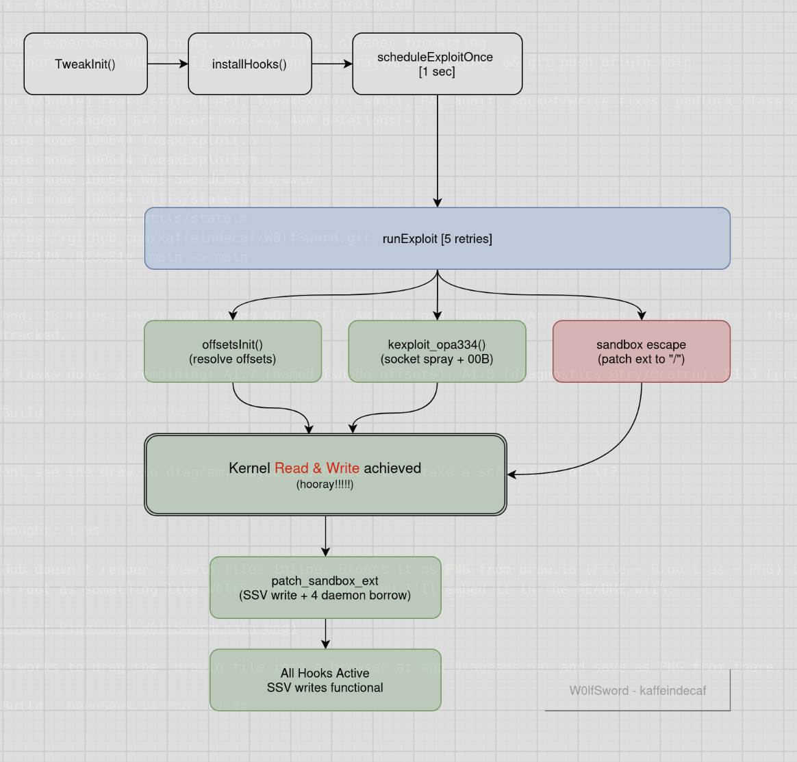

<h1 align="center">W0lfSword</h1>

<p align="center">
  <strong>Kernel research on iOS. Kernelcache research from your desk.</strong>
</p>

<p align="center">
  <a href="#quick-start">Quick start</a> ·
  <a href="#architecture">Architecture</a> ·
  <a href="#host-tools">Host tools</a> ·
  <a href="https://github.com/kaffeindecaf/W0lfSword/releases">Releases</a>
</p>

<p align="center">
  
</p>

W0lfSword brings **DarkSword kernel read/write and sandbox escape to Filza** on supported iOS builds. On Linux or macOS, the same toolkit can resolve offsets, compare kernelcaches and triage panic logs **without a phone attached**.

| On the device | On the host |
| --- | --- |
| Explore what Filza can access after a sandbox escape, and watch the chain run in its live log. | Compare iOS builds, track offset drift and map crash reports back to the relevant subsystem. |

## Quick start

Clone the repo and open the command index. This step only needs your computer:

```bash
git clone https://github.com/kaffeindecaf/W0lfSword.git
cd W0lfSword
./W0lfSword commands
```

For a device run, install the build tools with `sudo ./W0lfSword setup` on Linux or `./W0lfSword setup` on macOS. Then check the toolchain and your exact device combination:

```bash
./W0lfSword doctor
./W0lfSword exploits iPhone14,7 26.0.1  # Replace with your model and iOS version
```

> [!CAUTION]
> Use a lab device you own or are authorized to test. The kernel stage can panic the device. A reboot clears in-memory patches; files you modify can remain changed.

| Deployment path | When to use it |
| --- | --- |
| `sudo ./W0lfSword adderall --safe` | First deployment check on a jailbroken test device with Filza and OpenSSH. It builds and deploys the tweak but skips the kernel stage. Add `--usb` to use USB transport. |
| `./W0lfSword explain nojailbreak` | See the USB install workflow for a device without a jailbreak. It requires your own Filza IPA and is listed for iOS 18.0–26.0.1. The install workflow can run the kernel stage. |

W0lfSword requires a copy of Filza and does not jailbreak or recover a device.

## Architecture

On the main path, Filza loads the tweak and activates the UI hooks. DarkSword (CVE-2025-43520) can then provide kernel read/write, which the tweak uses to patch Filza's sandbox rules and enable access through the sealed system volume (SSV) path. File operations still happen through Filza's usual browser.

| System architecture | Exploit chain |
| :---: | :---: |
| <a href="W0lfSwordArchitecture.png"></a> | <a href="W0lfSwordChain.png"></a> |
| How the tweak, kernel primitives and offset resolver fit together. | How execution moves from Filza startup to sandbox and system volume access. |

Select either diagram to view it at full size. The chain diagram shows the main path; release builds use the staged checks described below.

## Compatibility and safety

- **Kernel stage:** Listed for supported combinations from iOS 17.0 through 26.0.1. The `pe_v1` path covers A12–A17; `pe_v2` covers A18. Check `./W0lfSword exploits <model> [ios]` for your exact combination.
- **iOS 26.1 and later:** Apple patched this DarkSword kernel path in 26.1. Userspace techniques have their own support windows, which the CLI reports separately.
- **Release builds:** Staged mode can move from a compatibility check to a write probe and then the full chain. Use `adderall --safe` to verify deployment without running the kernel stage.
- **After a panic:** Save the crash report before retrying; a later panic may replace it. See the [threat model](docs/THREAT_MODEL.md) for the limits of each path.

## Host tools

Start with `./W0lfSword offsets` to see existing coverage or `./W0lfSword explain <command>` for usage.

| Command | What it helps you do |
| --- | --- |
| `kernelcache` | Extract a kernelcache, resolve offsets or diff two builds. |
| `diffs` · `drift` | Inspect published build diffs and identify offsets that need re-verification. |
| `kcwatch` | Check new builds and report offset changes. |
| `panic analyze <file>` | Classify a saved iOS panic report. |
| `cve [filter]` · `chains` | Browse the CVE and attack-chain catalogs. |

The [research index](research/README.md) covers the kernelcache scripts, fuzzers and proof-of-concept tools. Some PoC and fuzzing commands interact with a device; check their help before running them.

## Build and verify

The build uses Theos, clang, an iPhoneOS SDK and `dpkg-deb`. Run `./W0lfSword doctor` to check your setup.

```bash
make package
./W0lfSword audit
bash scripts/check_host_verification.sh
```

Add `--with-builds` to the verification script to include Theos cross-builds. These checks run on the host.

| Where to go next | What you'll find |
| --- | --- |
| [Kernel primitives](kexploit/) · [Exploit sequencing](TweakExploit.m) | The kernel read/write implementation and staged execution. |
| [Offset resolution guide](docs/OFFSET_RESOLUTION_GUIDE.md) | How to research offsets for a new iOS build. |
| [W0lfSword Hub](pocs/hub_shell/README.md) | The companion app, its build workflow and install modes. |
| [Roadmap](ROADMAP.md) · [Arctic Wolf art asset](scripts/wolf_art.txt) | Open work and the source art for the Hub icon. |

## Credits

[Huy Nguyen](https://github.com/34306/) (FilzaJailedDS), [wh1te4ever](https://github.com/wh1te4ever/) (DarkSword and XPF offset engine), [opa334](https://github.com/opa334/) (XPF, kernel primitives and sandbox structures), [khanhduytran0](https://github.com/khanhduytran0/) (sandbox hook tokens), [CrazyMind90](https://github.com/CrazyMind90/) (sandbox token acquisition), [XEmaz](https://x.com/XEmaz_) (SSV bypass and Filza hooks) and [kaffeindecaf](https://github.com/kaffeindecaf/) (integration, device support and tooling).

See [LICENSE](LICENSE). Third-party code remains under its original licenses.
